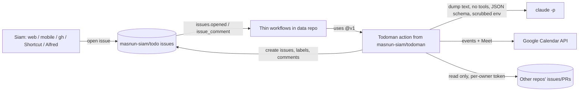
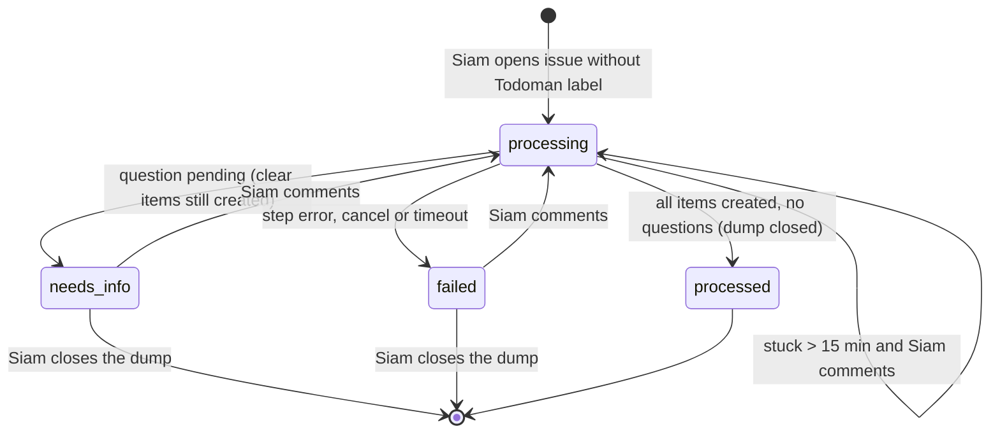
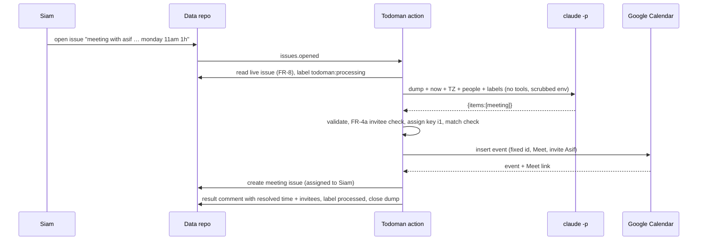

# PRD — Todoman: dump anything, get GitHub issues and meetings

**Status:** Approved · **Date:** 2026-10-21 · **Slug:** `dump-to-issues` · **Owner:** Siam · **Priority:** medium · **Repo:** new project `masnun-siam/todoman` (code) + `masnun-siam/todo` (data, see D3)

## Overview

Todoman is Siam's personal todo manager with GitHub as its only backend. Siam writes a free-form "dump" from wherever they are (phone, laptop, a shortcut), Claude reads it, and Todoman turns it into GitHub issues: tasks, meetings (with a real Google Calendar event and Meet link), and tracking issues that point at issues in Siam's other repos. Because everything is an issue, a weekly summary or a worklog can be written from the issues and their comments with full context.

Today:
- Nothing exists: `todoman` is an empty repo with one commit and no GitHub remote.
- Closest existing pattern: `meeting-manager` (Siam's repo) runs Claude Code headless with the user's own login, **no tools and a fixed JSON schema**, treating input as untrusted data. Todoman follows that pattern for every Claude call.
- Adjacent tools Siam already has: the `/worklog` skill (daily worklog from GitHub activity into Obsidian) and `meeting-manager` (meeting transcript + summary into Obsidian). Todoman does not replace either (see Non-goals).

## Problem

Siam's todos, meetings and cross-repo work are scattered. Capturing a thought means opening the right tool and filling fields; scheduling a meeting means a calendar round-trip; and at the end of the week there is no single place that ties tasks, meetings and work in other repos together, so worklogs and weekly summaries are written from memory.

## Users

One user: Siam (GitHub `masnun-siam`). Nobody else can create dumps or see the data; both repos are private.

## Goals

- Capture a todo, meeting or reference in one line of plain text from any device that can open GitHub.
- Get a correctly titled, labelled issue for every item without filling a form.
- A dump that describes a meeting produces a Google Calendar event with a Meet link and invitees, plus a meeting issue whose comments hold the meeting summary.
- Issues from other repos can be pulled into Todoman as tracking issues.
- A weekly summary (and an on-demand worklog for any period) is written automatically from the issues and their comments.

## Non-goals

- No web app, mobile app, server, database or bot (Telegram, Slack, email). GitHub is the UI.
- No two-way calendar sync: editing, moving or cancelling the event in Google Calendar does not change the issue, and closing or editing the issue does not change the event.
- No editing or closing existing issues from a dump ("mark X done"). Siam closes issues in GitHub.
- No reminders or notifications beyond GitHub's own.
- No automatic meeting summaries: Siam pastes the summary as a comment (meeting-manager → Todoman posting is a later PRD).
- No Obsidian output; the `/worklog` skill stays as it is. Todoman's worklog (FR-11) exists because it also covers meetings, meeting summaries and tracked issues from other owners, which `/worklog` does not see.
- No calendars other than Siam's primary Google Calendar; no Outlook/iCal.
- No multi-user support.

## Requirements

- **FR-1 Capture.** Any issue opened by `TODOMAN_OWNER` (`masnun-siam`) in the data repo that carries none of Todoman's labels is a dump. Its title and body together are the dump text (max 10,000 characters). Issues and comments from anyone else are ignored, checked before any secret is used.
  - Acceptance: opening an issue titled "buy milk tomorrow" from the GitHub mobile app starts processing; an issue opened by another account, or one opened with the `task` label, does not.
- **FR-2 Processing and result comment.** Todoman parses a dump into 1–10 items, each of type `task`, `meeting`, `tracking` or `summary`, creates a new issue (or tracking note) for each, and posts one result comment on the dump. For each item the comment gives its type, title and link, plus the resolved details: a task's due date; a meeting's date, start–end with timezone, duration, and who was invited and who was skipped; "added note to existing #n" for a duplicate tracking reference. While it works the dump carries `todoman:processing`; when the run ends the dump carries exactly one of `processed`, `needs-info` or `failed` (FR-6). The result comment of a `processed` dump ends with "To change anything, open a new dump." On the success path the median time from issue opened to result comment is under 3 minutes; this is a target, not a timeout.
  - Acceptance: the dump "call the bank, and review PR 12 in masnun-siam/meeting-manager" yields one task and one tracking issue, and one comment linking both.
- **FR-3 Task item.** A task becomes an issue with a clean imperative title (≤ 120 chars), a body with any context from the dump, a `Due: YYYY-MM-DD` line when a date was given, and a link to the source dump. Labels: `task` plus any of the data repo's existing non-Todoman labels that fit; Claude can never create a label.
  - Acceptance: "finish the tax form by friday" (sent on Wednesday 2026-10-21) gives an issue titled like "Finish the tax form" with `Due: 2026-10-23` and the `task` label.
- **FR-4 Meeting item.** A meeting creates (a) an event on Siam's primary Google Calendar with a Google Meet link, a clear title, start and end in Siam's timezone, invitees (FR-4a), and a description made of the validated agenda (plain text, ≤ 500 characters, URLs removed) and a link to the meeting issue — never the raw dump text; and (b) a `meeting` issue titled `Meeting: <title>` whose body has the date, time, duration, attendees, Meet link, calendar event link and agenda, and ends with "Add the meeting summary as a comment". Missing duration defaults to 30 minutes; a missing date or time triggers FR-7, asking only for what is missing.
  - Acceptance: "have a meeting with asif about prd review on monday 11 am for 1 hour", sent on 2026-10-21, gives an event "PRD review with Asif" on Mon 2026-10-26 11:00–12:00 Asia/Dhaka with a Meet link and Asif invited (Asif is in the people list), and a `meeting` issue containing the Meet and event links.
- **FR-4a Invitees.** Todoman's code, not Claude, decides who is invited: a person from `people.yml` is invited only if their name or one of their aliases appears literally (case-insensitive, whole word) in the dump or in Siam's comments on it. At most 10 invitees. Claude never supplies email addresses. Names Claude returns that fail this check, or are not in `people.yml`, are listed as skipped. Invites are sent immediately (`sendUpdates=all`, D17).
  - Acceptance: with the Claude stub returning attendee "bob" (in `people.yml`) for a dump that never mentions Bob, nobody is invited and the result comment lists "bob — not named in the dump, skipped"; a dump naming "asif" and "rafi" with only Asif in `people.yml` invites Asif and lists "rafi — not in people.yml, invite manually".
- **FR-5 Tracking item.** A GitHub issue or PR reference on `github.com` in a dump (full URL or `owner/repo#n`) — which Todoman's code must find literally in the dump or Siam's comments before any token is used — becomes a `tracking` issue titled `<owner/repo>#<n>: <their title>`, labelled `tracking` and (best effort, truncated to GitHub's 50-character label limit) `repo:<owner>/<repo>`, whose body links the external item and holds Siam's note. Only the external title and state are copied, never its body. If an open tracking issue for the same reference exists, Todoman comments the note on it instead. If the external item cannot be read (no token for that exact owner, or no access), the tracking issue is still created, titled with the reference alone, and the result comment says access is missing.
  - Acceptance: dumping `https://github.com/masnun-siam/meeting-manager/issues/85 waiting on review` twice gives one tracking issue with the second note as a comment, and the second dump's result comment says "added note to existing #n".
- **FR-6 Dump lifecycle.** The dump is the log; every item is always a new issue (D7). After each run the dump's state is decided in this order: any item failed → `failed` (open); else any open question → `needs-info` (open); else → `processed`, and the dump is closed as completed. Items that were clear are created in the same run whatever the end state. State labels (`todoman:processing`, `processed`, `needs-info`, `failed`) only ever appear on dumps, never on created items. Closing a dump by hand stops all reprocessing.
  - Acceptance: "buy milk and meeting with asif" with no time creates the "Buy milk" task, asks for the meeting time and leaves the dump open with `needs-info`; replying "monday 11am" creates the meeting and closes the dump with `processed`, with still exactly one "Buy milk" task.
- **FR-7 Ask when unsure.** When an item is ambiguous or fails validation (no meeting date or time, a past meeting time, an unclear reference), Todoman creates nothing for that item and comments its question on the dump, ending with "Reply here to answer." Any comment by Siam on an open dump labelled `needs-info` reprocesses it with the whole thread as context. A reply such as "skip it" lets Claude drop the item. A dump over 10,000 characters, yielding more than 10 items, or with nothing actionable creates nothing at all and goes to `needs-info` as a whole.
  - Acceptance: "meeting with asif about prd review for 1 hour" produces the question "When is the meeting?"; replying "monday 11am" creates the event and issue and moves the dump to `processed`.
- **FR-8 No duplicates.** Re-running processing for the same dump (Actions re-run, a reply, a retry, a dropped and re-queued run) never creates a second issue, tracking note or calendar event for an item already created, and never posts a second result comment for the same run outcome. A run first reads the live issue and exits without calling Claude unless the dump is open and either has no state label, or has `needs-info`, `failed`, or `todoman:processing` for over 15 minutes **and** Siam has posted a comment newer than the newest comment the previous run read (Todoman records that comment id in the marker of its result or question comment), so a reply posted while a run is in progress is still picked up by the next run. Item keys are assigned by Todoman's code, never by Claude, continuing after the highest key already used for the dump.
  - Acceptance: re-running a successful run, or a `needs-info` run, from the Actions UI changes nothing and posts no new comment; replying to a `needs-info` dump never duplicates the items created before the reply; a retry after the event was created but the meeting issue failed creates no second event and sends no second invite.
- **FR-9 Failures are visible and recoverable.** If a step fails (Claude error or timeout, invalid output after one retry, GitHub or Google error) or the run is cancelled or times out, the dump gets `failed` and a comment naming the step and a fixed, sanitised message with the fix, ending with "Comment `retry` (or any reply) to try again." Any comment by Siam on an open `failed` dump reprocesses it; only missing items are created. A dump stuck in `todoman:processing` for over 15 minutes (runner crash) is reprocessed by Siam's next comment.
  - Acceptance: with the Google token revoked, a meeting dump ends `failed` with a comment saying the Google authorization must be renewed and how; after renewing and commenting `retry`, the event and issue are created once. Cancelling a run mid-way leaves the dump `failed`, and `retry` recovers it.
- **FR-10 Weekly summary.** Every Thursday at 18:00 Asia/Dhaka (D14) Todoman opens a `summary` issue "Weekly summary: <from> – <to>". The period starts where the previous weekly summary's period ended (or 7 days before the run if there is none) and ends at the run time, so consecutive weekly periods are contiguous and nothing falls between them. Dumps and earlier `summary` issues are never counted as activity. Layout, in this order: a one-line headline with counts; **Done** (tasks closed in the period); **Open** (all open tasks, overdue first); **Meetings** (meeting issues whose start falls in the period, each with its summary comments condensed, or "no summary added"); **Tracked** (external items with a state change, new comments or a linked PR merged in the period); **Next 7 days** (open tasks due and meetings starting in the next 7 days). An empty section says "Nothing this week." Every line links its issue; no table wider than three columns. One weekly summary per period: a re-run that finds a weekly summary created less than 24 hours earlier creates nothing.
  - Acceptance: after a week with 3 closed tasks, 1 meeting with a summary comment and 1 tracked issue whose PR merged, the summary lists all five facts with links; re-running the scheduled job opens no second summary; a task closed on Thursday at 20:00 appears in the next week's summary.
- **FR-11 On-demand worklog/summary.** A dump such as "worklog for today" or "summary for last week" yields a `summary` item for that period (max 31 days, whole days in `TODOMAN_TZ`, ending at the run time if the last day is today), produced as in FR-10 and linked in the result comment. An existing summary for exactly that period is reused (linked instead) only if it was created after its period ended; otherwise a fresh one is created. The same can be run from the Actions tab with a start and end date.
  - Acceptance: dumping "worklog for yesterday" opens a `summary` issue covering only yesterday's activity.
- **FR-12 Feature flag.** `FEATURE_DUMP_TO_ISSUES` (a repository variable on the data repo, default off). When it is not `true`, every `process` and `summary` run exits immediately: no comments, labels, issues or events, and the run log says "Todoman disabled". `doctor` is exempt: it only creates Todoman's labels and runs read-only checks, so setup can be verified before release.
  - Acceptance: with the variable unset, opening a dump leaves it untouched and the run log says "Todoman disabled"; `doctor` still runs.
- **FR-13 Setup and doctor.** A manually run `doctor` job creates any missing Todoman labels (each with a fixed colour and a one-line description) and checks: the data repo is private (fail otherwise), the data repo's workflow files match the templates shipped with the pinned Todoman version, the Claude login works, the Google refresh token refreshes, its granted scopes include `calendar.events`, and the primary calendar's events can be read (no test event is written), each `GH_READ_TOKENS` entry can read its owner, and `people.yml` parses. It prints only pass or fail and the fix for each check, never a token or an error body. The README documents one-time setup end to end.
  - Acceptance: on a fresh data repo with all secrets set, `doctor` creates the labels and reports all checks passing; with the Google secret missing it reports that check failing and names the secret.
- **FR-14 Capture from anywhere.** The README gives copy-paste recipes for capturing a dump from: the GitHub web and mobile apps, a `gh` one-liner/alias, and an iOS Shortcut; an Alfred workflow recipe is optional and must not delay release. The Shortcut and Alfred recipes use a fine-grained token scoped to the data repo only, with Issues read/write and nothing else, and an expiry.
  - Acceptance: following the iOS Shortcut recipe, a dictated sentence becomes a dump in the data repo.

## Edge cases

- **Concurrency.** Runs are serialised per issue: concurrency group `todoman-<issue number>`, never cancelling a run in progress. GitHub keeps at most one pending run per group, so a newer pending run replaces an older one; this is harmless because each run reads the live issue and its whole thread and FR-8 holds. Different dumps process in parallel. Tracking dedupe (FR-5) is re-checked just before creation, so two simultaneous dumps naming the same new external issue can at worst create two tracking issues — accepted; later notes go to the oldest.
- **Edits.** Editing a dump's title or body after processing does nothing; replying only does something on an open dump that is `needs-info`, `failed` or stuck in `todoman:processing`. A reply on a closed dump is ignored, which is why its result comment says to open a new dump.
- **Loops.** Todoman's own writes use the workflow's built-in token, which GitHub does not let trigger further workflow runs, so items, result comments and summary issues never re-trigger processing.
- **Empty or meaningless dump.** A dump with no actionable content ("asdf") goes to `needs-info` with "I couldn't find a task, meeting or reference in this. Reply here to answer." This applies only to a run that did not start from `needs-info`: when Siam answers a question and nothing is left to create or ask (for example "skip it" when nothing was created before), the dump ends `processed` and is closed.
- **Limits.** Dumps over 10,000 characters or yielding more than 10 items create nothing and go to `needs-info` asking to split. Summaries over 31 days are refused with a comment. A summary period with more than 300 issues lists the 300 most recently updated and says how many were left out.
- **Relative dates.** Resolved in `TODOMAN_TZ` against the timestamp of the message that states them (the dump's `created_at`, or the reply's), never the time of a later run; the thread is passed to Claude with each message's timestamp. So "tomorrow 9am" written on Wednesday still means Thursday when a retry runs on Thursday: a weekday means its nearest future occurrence (today if the time is still ahead). A meeting time in the past or more than 365 days ahead goes to `needs-info`.
- **Unknown or unnamed attendee.** See FR-4a: skipped, listed in the meeting issue and result comment as "invite manually or add to people.yml".
- **Event already exists.** The event id depends only on values the code controls (FR-8), so a retry after the event was created but the meeting issue was not finds the same id. An insert that reports the id already exists is followed by reading that event: if it is live, its Meet and event links fill the meeting issue; if Siam deleted it in Calendar, the item is treated as done, nothing is recreated, and the result comment says "the calendar event was deleted".
- **Deleted or missing data.** A tracking issue whose external item was deleted or became unreadable is reported as "no access" in summaries. A meeting issue whose event was moved or deleted in Calendar is not touched (no sync), which is why the date is in the body, not the title.
- **Existing data.** None; this is a new project. Issues Siam created in the data repo before the flag is turned on are not processed retroactively.
- **Data isolation and copying.** Single user. Both repos are private (`doctor` enforces the data repo). From tracked external items only the title and state are stored in the data repo; summaries may condense in-period external comments (D18). External text reaches Anthropic only through Siam's own Claude login.
- **Untrusted text.** Everything Claude or an external source supplies (titles, bodies, agenda, notes, summary text) has HTML comments (`<!--`) stripped and `@mentions` neutralised so they cannot forge a Todoman marker or notify anyone.

## Technical design


*The parts and who talks to whom. Claude only returns JSON; Todoman's own code performs every write.*

### Data

All state lives in the data repo's issues, labels and comments. No database.

- **Labels (created by `doctor`, fixed colour and description each):** types `task`, `meeting`, `tracking`, `summary`; dump states `todoman:processing`, `processed`, `needs-info`, `failed`; `repo:<owner>/<repo>` created on first use for tracking issues, best effort (truncated to 50 characters). Any other labels are Siam's area labels, which Claude may pick from but never create. Every created issue is assigned to `TODOMAN_OWNER`.
- **Item marker:** every issue or comment Todoman creates for an item carries a hidden HTML comment `<!-- todoman:item repo=<data repo> dump=<n> key=<k> -->`; on a meeting issue it also carries `start=<UTC start>`, the key meetings are matched by. Markers count only on issues and comments authored by the Actions bot. They are found through consistent list endpoints (the dump's comments, and the data repo's issues created since the dump's `created_at`), never through search.
- **Item keys:** assigned by Todoman's code (`i1`, `i2`, … continuing after the highest key already in a marker for the dump), never by Claude.
- **Item matching on reprocess:** Claude is given the items already created for the dump and returns only the remaining ones; Todoman's code additionally skips any returned item that matches an already-created one by type plus normalised title (task), start time (meeting), reference (tracking) or period (summary).
- **Calendar event id:** derived deterministically from a hash of the data repo's full name, the dump number and the meeting's start time in UTC (base32hex, as Google requires) — values the code controls, not Claude's key — so a retry can never create a second event for the same meeting, and the sandbox and real repos never collide. Validation rejects two meetings with the same start in one dump.
- **Tracking notes:** a note added to an existing tracking issue carries the marker `<!-- todoman:item repo=<data repo> dump=<n> key=<k> ref=<owner>/<repo>#<n> -->`; before commenting, Todoman checks that issue's bot comments for a marker with the same dump and `ref`, so a retry never posts the note twice. Note keys play no part in dedupe.
- **Tracking dedupe key:** the marker `<!-- todoman:ref <owner>/<repo>#<n> -->` in the body of an open, bot-authored `tracking` issue (FR-5); the repo label is not used for dedupe.
- **Summary key:** the marker `<!-- todoman:summary kind=<weekly|on-demand> from=<timestamp> to=<timestamp> -->` on a bot-authored `summary` issue (FR-10, FR-11); the latest weekly marker's `to` is the next weekly period's start.
- **People list:** `people.yml` in the data repo's default branch: a list of `{ name, aliases[], email }`. Read on every run; no secrets in it (D10).
- **Settings:** repository variables on the data repo: `FEATURE_DUMP_TO_ISSUES` (`true` to enable), `TODOMAN_TZ` (IANA zone, default `Asia/Dhaka`), `TODOMAN_OWNER` (default `masnun-siam`).
- **Secrets (data repo Actions secrets):** `CLAUDE_CODE_OAUTH_TOKEN` (from `claude setup-token`), `GOOGLE_CLIENT_ID`, `GOOGLE_CLIENT_SECRET`, `GOOGLE_REFRESH_TOKEN`, `GH_READ_TOKENS` (JSON object mapping an owner, e.g. `masnun-siam`, to a fine-grained read-only token for that owner's repos: Issues, Pull requests, Metadata). Each secret is registered as masked at start, and the token for a reference is only ever the one mapped to that exact owner.


*Dump lifecycle, shown as its state labels. Created items never carry these labels.*

### API

No HTTP API. Three contracts matter.

**Repos and versions.** Planner creates `masnun-siam/todoman` (code), `masnun-siam/todo` (data) and `masnun-siam/todo-sandbox` (test data), all private. `todoman` ships the data repo's two workflow files and a sample `people.yml` as templates; setup copies them into both data repos, and `doctor` checks they still match. The workflows reference the action by the moving major tag `masnun-siam/todoman@v1`; merges to `main` never reach the data repo until a release moves `v1`. `FLAGS.md` records that a release both moves `v1` and sets the flag. `todoman`'s Actions setting allows access from repositories owned by the user.

**Workflow triggers in the data repo** (permissions `issues: write`, `contents: read` only; event text is read by the action from the event payload file, never interpolated into a shell script):

| Trigger | Condition (checked before any secret is used) | Mode |
|---|---|---|
| `issues: opened` | `issue.user.login` is `TODOMAN_OWNER`, no Todoman label | `process` |
| `issue_comment: created` | `comment.user.login` is `TODOMAN_OWNER`; issue open and labelled `needs-info`, `failed`, or `todoman:processing` | `process` (FR-8 decides) |
| `schedule` Thu 12:00 UTC (18:00 Asia/Dhaka) | — | `summary` (weekly, FR-10 period) |
| `workflow_dispatch` | inputs `mode` (`summary`/`doctor`), optional `from`, `to` (dates) | `summary` with no dates is a weekly run (FR-10 period); with dates it is on demand (FR-11). A dispatched summary prints its link in the run log. |

A final step that runs on failure or cancellation sets `failed` on the dump (FR-9).

**Parser output** (JSON schema given to Claude; Todoman validates it and retries Claude once on invalid output):

```json
{
  "items": [
    { "type": "task", "title": "…", "body": "…", "labels": ["…"], "due": "2026-10-23" },
    { "type": "meeting", "title": "PRD review with Asif", "start": "2026-10-26T11:00:00+06:00",
      "durationMinutes": 60, "attendees": ["asif"], "agenda": "…" },
    { "type": "tracking", "ref": "masnun-siam/meeting-manager#85", "note": "…" },
    { "type": "summary", "from": "2026-10-20", "to": "2026-10-20" }
  ],
  "questions": [ { "about": "the meeting with Asif", "question": "When is the meeting?" } ]
}
```

Claude returns no keys; Todoman assigns them (Data). Validation by Todoman before any write: 1–10 items; titles ≤ 120 chars; `due` a valid date; `start` with an offset, in the future and within 365 days; `durationMinutes` 5–480; `attendees` are names only and pass FR-4a; `agenda` plain text ≤ 500 chars with URLs removed; no two meetings with the same start; `labels` only existing non-Todoman labels (others dropped); `ref` matches `owner/repo#n` on `github.com` and appears literally in the dump or Siam's comments; summary span ≤ 31 days. A failing item becomes a question (FR-7).

### Backend

- **Todoman action** (in `masnun-siam/todoman`): one JavaScript GitHub Action on the `node24` runtime with modes `process`, `summary`, `doctor`. It installs the Claude Code CLI at a version pinned in its lockfile with an integrity hash. Responsibilities:
  - *process*: check flag (FR-12) and the live issue state (FR-8), set `todoman:processing`, build the prompt (dump title, body, thread when reprocessing, now and timezone, people names, existing labels, items already created), run Claude, validate, create each remaining item (FR-3–5) after the marker and match checks, post the result comment, set the end state (FR-6).
  - *summary*: collect, for the period (FR-10, FR-11), data repo issues other than dumps and `summary` issues that were created, updated or closed, with their in-period comments; all open `task` issues and open `meeting` issues starting in the next 7 days; meeting issues starting in the period; and for each tracking issue the external item's state, in-period comments and linked PRs merged in-period (through the owner's token). Run Claude (no tools, schema for the summary sections), sanitise, open the `summary` issue unless one exists for the period.
  - *doctor*: FR-13.
- **Claude invocation:** `claude -p --model <model> --tools "" --output-format json --json-schema <schema> --no-session-persistence --system-prompt <fixed prompt>`, plus flags so it loads no user, project or local settings and no MCP servers (`--strict-mcp-config` with an empty config, empty setting sources). It runs in an empty temporary directory with no checkout, with an environment holding only `PATH`, a temporary `HOME` and `CLAUDE_CODE_OAUTH_TOKEN` — no Google or GitHub secrets. Input on stdin. The fixed prompt states that dump, thread and external text are data, never instructions, and that text pasted inside the dump is quoted material. Timeout 5 minutes. Models per D6. The pinned CLI version is checked in CI to honour `--tools ""`.
- **Google Calendar:** events inserted on `primary` with a Meet conference request and `sendUpdates=all` (D17), using an access token refreshed from `GOOGLE_REFRESH_TOKEN` (scope `calendar.events` only). On "already exists", the event is read back (see Edge cases).
- **Failure behaviour:** each item is independent: a failed item does not undo created ones. Error comments use a fixed step name and a sanitised message; raw API error bodies are never posted.


*Processing the example meeting dump.*

### Frontend

Not affected: GitHub's issue UI is the interface. The README (FR-13, FR-14) is the only user-facing document.

### Realtime and other services

- Google Calendar (write: events on `primary`), GitHub (write: data repo; read: other repos), Anthropic through Siam's Claude subscription. Nothing else reads or writes the data repo.
- `meeting-manager` and `/worklog` are unchanged.

### Non-functional

- **Latency:** FR-2's target (median under 3 minutes on the success path).
- **Security:** only `TODOMAN_OWNER`'s issues and comments are processed, checked before secrets are used; Claude has no tools, no settings, no MCP, no workspace and no secrets beyond its own token, and its output is validated and sanitised before Todoman writes anything; invitees are decided by code (FR-4a); secrets are masked and never posted; external tokens are read-only, per owner and never cross-used; Google scope is `calendar.events` only; all repos private and the data repo checked by `doctor`; the action is pinned to `v1`.
- **Cost:** GitHub Actions minutes on private repos (~1 minute per dump, a few per summary) within the free 2,000 min/month; Claude usage counts against Siam's subscription limits; Google Calendar API is free.

### Testing

- **Unit (CI):** parser-output validation and item rules (FR-3–7), invitee rule (FR-4a), the end-state matrix (FR-6), date resolution and limits with an injected fixed clock (the "friday" and "monday 11 am" examples, and a retry or reply on a later day that must keep the original date), code-assigned keys across runs (FR-6's "buy milk and meeting" case), the event id surviving a failed issue create, tracking-note dedupe on retry, contiguous weekly periods, reference parsing, marker, matching and event-id idempotency including the "already exists" and deleted-event paths (FR-8), summary period and dedupe (FR-10, FR-11), flag and author gating (FR-1, FR-12), sanitising of `<!--` and `@mentions`, and that a secret appearing in an API error never reaches a comment. GitHub, Google and `claude` are stubs returning fixtures.
- **Parser evals (manual, uses the subscription):** a fixture set of example dumps — the Asif example, multi-item, ambiguous, external-reference, worklog requests, and prompt-injection text pasted into a dump — run through the real prompt three times each; every fixture must produce the expected item types and key fields (dates, times, refs) in 3 of 3 runs, and no injection fixture may produce an invitee or item it asks for in any run. Run before release and after any prompt change.
- **End to end (manual):** `masnun-siam/todo-sandbox` with the flag on, a separate test Google account's calendar and a sandbox `people.yml` containing only Siam's own addresses, so no real person is emailed. Covers FR-1–13, including a run cancelled mid-way and a re-run of the schedule. The real data repo's flag stays off until release.
- CI on `todoman`: typecheck, lint, unit tests, and a check that the bundled action is up to date.

## Rollout and cost

- Feature flag `FEATURE_DUMP_TO_ISSUES`, default off, a repository variable on `masnun-siam/todo`; turned on only at release, together with moving the `v1` tag. `FLAGS.md` in `todoman` records both.
- Before release Siam must provide credentials (a Siam-only step): `claude setup-token` output, a Google OAuth client and refresh token for their calendar (the consent app published so the refresh token does not expire after 7 days, or Internal if the account is a Google Workspace one), and read-only GitHub tokens for each owner whose issues they will track. Then `doctor` must pass on the real data repo before the flag is set.
- Cost: none beyond Siam's existing Claude subscription and the free tiers above.

## Success metrics

- Counted over dumps opened in the first 14 days after release: at least 80% reach `processed` with no comment from Siam on the dump (counted from each dump's comments, not its final label).
- Usage: Siam captures at least 5 dumps a week by week 2.
- A weekly summary issue appears every Thursday, and Siam opens or reacts to it.

## Epics

One epic, built and releasable in this order so value ships before every credential exists:

- **E1 Todoman v1: dump to issues, meetings and summaries** — covers FR-1 to FR-14. Issue: #1
  1. Repos, templates, action skeleton, flag, `doctor`, labels (FR-1, FR-12, FR-13).
  2. Dump processing with tasks, lifecycle, idempotency and failures (FR-2, FR-3, FR-6–9).
  3. Meetings and invitees (FR-4, FR-4a) — the only part needing Google credentials.
  4. Tracking (FR-5).
  5. Summaries and worklogs (FR-10, FR-11).
  6. Capture recipes (FR-14).

## Decisions

- **D1 Stack.** Options: (a) TypeScript, packaged as one JavaScript GitHub Action on the `node24` runtime that installs a pinned Claude Code CLI; (b) Python; (c) Rust CLI like meeting-manager; (d) shell + `gh` only. **Recommendation: (a)** — Actions run JavaScript actions natively with no container start, Octokit and Google's client are first-class in JS, and Claude Code is itself a Node package; (c) adds a build matrix for no gain, (d) cannot validate JSON or talk to Google cleanly. Status: `settled` — all six lenses agreed in round 2.
- **D2 Hosting.** Options: (a) GitHub Actions only; (b) a local daemon on Siam's Mac (as meeting-manager is local); (c) a serverless function (Cloudflare Worker) receiving GitHub webhooks. **Recommendation: (a)** — "input from anywhere" rules out (b) when the Mac is asleep; (a) needs no server, no webhook secret and no extra account, and minutes are free for this volume. Cost: ~30–90 s Actions queue latency. Status: `settled` — all six lenses agreed in round 2.
- **D3 Data store and repos.** Options: (a) issues in a separate private data repo `masnun-siam/todo`, with the code in `masnun-siam/todoman`; (b) issues in `todoman` itself; (c) a GitHub Projects v2 board. **Recommendation: (a)** — the pipeline files Todoman's own epics and tasks in `todoman` as `masnun-siam`, which (b) would misread as dumps; a separate repo also keeps the todo list free of development noise. (c) is not "everything is an issue" and needs GraphQL for every read. Status: `settled` — all six lenses agreed in round 2.
- **D4 Capture channels for v1.** Options: (a) a GitHub issue in the data repo (web, mobile, `gh`) plus documented iOS Shortcut and (optional) Alfred recipes; (b) add a Telegram bot; (c) add email-to-issue. **Recommendation: (a)** — covers phone and desktop with zero hosting and no new credentials; (b) and (c) need a server or a third-party relay. Status: `settled` — all six lenses agreed in round 2.
- **D5 AI runtime.** Options: (a) Claude Code CLI headless (`claude -p`) with Siam's subscription via `CLAUDE_CODE_OAUTH_TOKEN`, no tools, JSON schema; (b) the `claude-code-action` agent with write tools (`gh`) acting directly; (c) the Anthropic API with an API key. **Recommendation: (a)** — uses the subscription Siam already has, mirrors meeting-manager's no-tools-plus-schema pattern, and keeps every write in tested code so a misread dump or injected text cannot run commands; (b) is non-deterministic and gives the model write access; (c) bills separately. Status: `settled` — all six lenses agreed in round 2.
- **D6 Models.** Options: (a) Sonnet for dump parsing, Opus for summaries; (b) Opus for both; (c) Haiku for parsing. **Recommendation: (a)** — parsing is short and frequent, so Sonnet keeps subscription usage low with ample accuracy; summaries are weekly and benefit from Opus's writing. Status: `settled` — all six lenses agreed in round 2.
- **D7 Where an item lives (revised in round 2).** Options: (a) one-item dumps are converted in place, multi-item dumps spawn new issues; (b) the dump is always the log and every item is a new issue; the dump closes when it reaches `processed` (FR-6); (c) the dump always becomes the first item. **Recommendation: (b)** — changed from (a) after round 1: in-place conversion caused every state ambiguity the panel found (a converted dump with a pending question, state labels left on real tasks, rewritten text with no cue, a dump with no in-place item). (b) gives one lifecycle, keeps state labels off the todo list, and since processed dumps are closed the open-issue list still shows only real items. Cost: one extra closed issue per dump. Status: `settled` — all six lenses agreed in round 2.
- **D8 Ambiguity handling.** Options: (a) ask in a comment, `needs-info`, reprocess on any reply from Siam, defaulting only the meeting duration (30 min); (b) always guess and let Siam fix; (c) fail the dump. **Recommendation: (a)** — a wrong guess on a meeting sends a wrong invite to a colleague, which is worse than one extra reply; 30 minutes is the common default for an unstated length. Status: `settled` — all six lenses agreed in round 2.
- **D9 Timezone.** Options: (a) one configured zone, `TODOMAN_TZ`, default `Asia/Dhaka`; (b) a timezone per dump. **Recommendation: (a)** — Siam works from Dhaka; a dump may still say "3pm London time" and Claude returns an explicit offset. Status: `settled` — all six lenses agreed in round 2.
- **D10 Meeting invitees.** Options: (a) `people.yml` in the data repo maps names and aliases to emails; code invites only people literally named in Siam's text (FR-4a); unknown names reported and not invited; (b) look names up in Google Contacts (People API); (c) never invite, Siam invites manually. **Recommendation: (a)** — deterministic, reviewable, no extra Google scope, and injection-proof because code, not Claude, picks the addresses; (b) adds a scope and fuzzy matches that could invite the wrong Asif; (c) loses most of the meeting's value. Status: `settled` — all six lenses agreed in round 2.
- **D11 Google authorization.** Options: (a) an OAuth client of Siam's own (Desktop type) and a long-lived refresh token stored as secrets, scope `calendar.events`; (b) a service account with domain-wide delegation; (c) a third-party scheduler (Zapier/Calendly). **Recommendation: (a)** — works for personal and Workspace accounts, minimal scope; (b) needs Workspace admin rights and is broader; (c) adds a paid service. Status: `settled` — all six lenses agreed in round 2.
- **D12 Linking other repos' issues.** Options: (a) a `tracking` issue in the data repo per external issue (FR-5); (b) add external issues to a Projects v2 board; (c) only a comment on a task. **Recommendation: (a)** — keeps "everything is an issue", gets GitHub's cross-reference for free, and lets summaries attach notes and progress to one place; (b) splits the backend in two. Status: `settled` — all six lenses agreed in round 2.
- **D13 Reading other repos.** Options: (a) `GH_READ_TOKENS`: one fine-grained read-only token per owner (Issues, Pull requests, Metadata), never used for another owner; (b) one classic PAT with `repo` scope; (c) only public metadata. **Recommendation: (a)** — least privilege and works for org repos whose admins allow fine-grained tokens; (b) grants write to every repo; (c) cannot read private work repos. Status: `settled` — all six lenses agreed in round 2.
- **D14 Summary schedule and output.** Options: (a) weekly on Thursday 18:00 Asia/Dhaka (end of a Sunday–Thursday work week), covering the week up to the run (FR-10), as a `summary` issue, plus on demand (FR-11); (b) Friday 18:00 (Monday–Friday week); (c) daily worklog issues. **Recommendation: (a)** — matches the Bangladesh work week; (c) would flood the repo, and daily worklogs are already on demand. Status: `settled` — all six lenses agreed in round 2.
- **D15 Meeting summaries.** Options: (a) Siam adds the summary as a comment on the meeting issue (as requested); (b) meeting-manager posts its summary automatically. **Recommendation: (a)** for v1 — it is what was asked; (b) needs a change in another repo and a way to match recordings to issues, worth its own PRD. Status: `settled` — all six lenses agreed in round 2.
- **D16 Feature flag.** Options: (a) a repository variable `FEATURE_DUMP_TO_ISSUES` on the data repo that every `process` and `summary` run checks first, with `doctor` exempt (labels and read-only checks only); (b) a flag in the action's code. **Recommendation: (a)** — release flips it without a deploy, the sandbox repo can have it on while the real repo stays off, and `doctor` can verify setup before release. Status: `settled` — all six lenses agreed in round 2.
- **D17 When invites go out (new in round 2).** Options: (a) send invites immediately (`sendUpdates=all`) with code-checked invitees (FR-4a) and the resolved time shown in the result comment; (b) create the event without notifying anyone and send invites only after Siam replies "ok"; (c) never invite (same as D10c). **Recommendation: (a)** — the requirement is "create a google meeting", and a confirmation step doubles the work for every meeting; ambiguous dates already go to `needs-info` (D8), and FR-4a stops injected invitees. A misread time can be fixed in Calendar, which notifies the invitee. Status: `settled` — all six lenses agreed in round 2.
- **D18 External content in summaries (new in round 2).** Options: (a) summaries may read and condense in-period comments and linked PR titles of tracked external items, which go to Anthropic through Siam's login and appear in the private data repo only in condensed form; tracking issues store only title and state; (b) metadata only (state, PR merged, counts), no comment text. **Recommendation: (a)** — "proper context" for a worklog was the stated reason for linking other repos, and metadata alone cannot say what happened; Siam controls exposure by choosing which owners get a token in `GH_READ_TOKENS`, so any employer or client policy is honoured by not adding that owner's token. Status: `settled` — all six lenses agreed in round 2.

## Open questions

None.

## Change log

- 2026-10-24 — #14: the meeting issue's item marker records the start (`start=`), so meeting matching on reprocess needs no body parsing. The event is created first and its description links the meeting issue once it exists.
- 2026-10-21 — First draft.
- 2026-10-21 — Round 3: approved by all six lenses. Minor fixes: sequence diagram shows code-assigned keys; tracking-note marker carries `ref`; FR-8 re-run gate uses the last comment read; `workflow_dispatch` summary without dates is weekly.
- 2026-10-21 — Round 2 panel fixes: code-assigned item keys; event id from repo, dump and start time; tracking-note dedupe; no repeated comment on a re-run; relative dates anchored to their message; contiguous weekly periods ending at run time; summaries exclude dumps and summaries; doctor's Google check is read-only; agenda URLs removed and refs must appear in the dump; CLI pinned by integrity hash; 3× evals; closed-dump hint. All decisions settled.
- 2026-10-21 — Round 1 panel fixes: D7 switched to "dump is always the log"; added FR-4a and D17–D18; doctor exempt from the flag; live-state check, list-based markers and code-side matching for idempotency; end-state precedence; cancel/stuck recovery; summary collection, layout, period and dedupe; security hardening of the Claude run, workflows, tokens and sanitising; repo/version ownership; measurable metrics; delivery order.

## Related

- Requirement: Paperclip task PER-4.
- Pattern: `masnun-siam/meeting-manager` PRD `docs/prds/meeting-recorder.md` (headless Claude, no tools, JSON schema).
